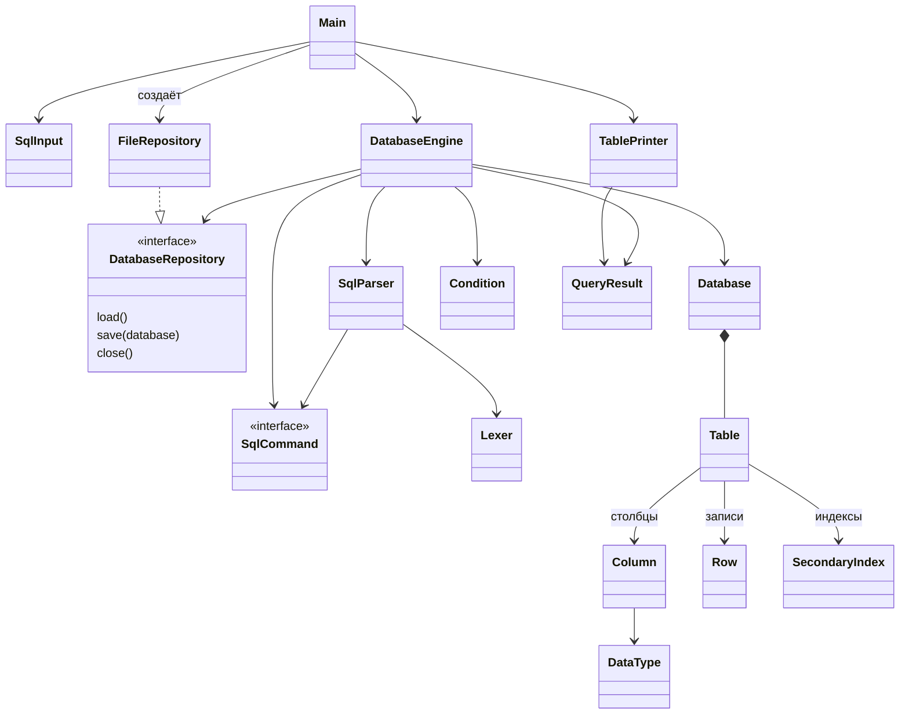
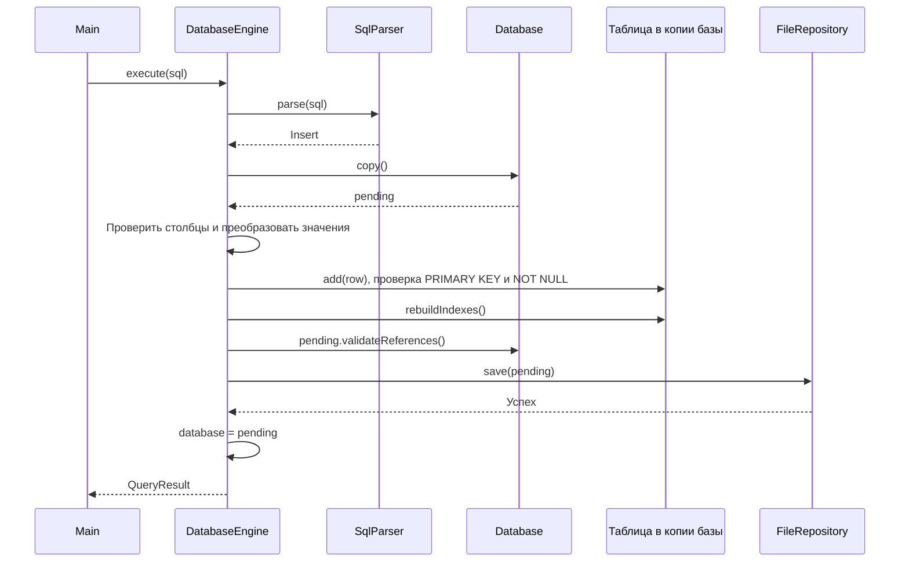

# Лабораторная работа 2. СУБД на Java

Предметная область — автосалон. Таблица `cars` хранит автомобили, `sales` — продажи. Поле `sales.car_id` ссылается на `cars.id`. Нужен JDK 8 или новее. Библиотек нет.

## Запуск

Открыть эту папку как проект в IntelliJ IDEA, выбрать JDK, отметить `src` как Sources Root и запустить `lab.minidb.Main`. Рабочая папка — папка этого README. `tests` можно отметить как Test Sources Root.

Или из PowerShell, если JDK указан в JAVA_HOME или PATH:

```powershell
.\build.ps1 run
.\build.ps1 test
.\build.ps1 benchmark
```

Путь к JDK можно передать явно. Замените `путь к установленному JDK` на путь к папке комплекта разработки Java 8 или новее, содержащей `bin\javac.exe` и `bin\java.exe`. Указывать саму папку `bin` не нужно. Кавычки оставьте. Подходит любой совместимый JDK, не только OpenJDK:

```powershell
.\build.ps1 run -Jdk 'путь к установленному JDK'
```

При первом запуске создаются пустые таблицы. При следующих — загружается папка `data`. Примеры ниже вводятся в консоли программы. Повторная вставка того же первичного ключа отклоняется.

Если Windows запрещает запуск скрипта, можно выполнить его так:

```powershell
powershell -NoProfile -ExecutionPolicy Bypass -File .\build.ps1 run -Jdk 'путь к установленному JDK'
```

## Файлы

В `src/lab/minidb` семь файлов:

| Файл | Назначение |
| --- | --- |
| Main.java | Ввод команд, разделение по `;`, вывод таблицы |
| Database.java | База, таблица, столбец, запись и типы данных |
| SqlParser.java | Разделение SQL на токены и разбор команды |
| SqlCommand.java | Объекты с параметрами разобранных команд |
| DatabaseEngine.java | Исполнение SQL, условия, проверки ограничений |
| SecondaryIndex.java | Индекс по значениям столбца |
| FileRepository.java | Сохранение и загрузка снимков базы |

Маленькие вспомогательные классы находятся в тех же файлах, где используются. В `tests` два файла: DatabaseTest.java с проверками и Benchmark.java с измерением скорости.

Папки `src` и `tests` разделяют программу и проверки. Вложенные папки `lab/minidb` соответствуют имени Java-пакета `lab.minidb`: это единое пространство имён для классов проекта.

В корне лежат `build.ps1` (сборка и запуск) и этот `readme.md` (описание по заданию). Папка `data` содержит рабочую базу. Папка `build` появляется при сборке и хранит `.class`, а после тестов — временные базы; её можно удалить и собрать проект заново.

Вспомогательные классы распределены так:

- `Main.java`: `SqlInput` собирает многострочные команды, `TablePrinter` выравнивает вывод.
- `Database.java`: `Table` хранит строки и индексы; `Column` описывает столбец и ограничения; `Row` хранит значения записи; `DataType` преобразует SQL-значения в типы Java.
- `SqlParser.java`: `Lexer` выделяет токены, сохраняя содержимое строк в кавычках.
- `SqlCommand.java`: отдельные небольшие классы для параметров SELECT, INSERT, UPDATE, DELETE и DDL, а также условия и литерала.
- `DatabaseEngine.java`: `Condition` проверяет условие; `QueryResult` передаёт результат в консоль; `DbException` обозначает понятную пользователю ошибку.
- `FileRepository.java`: интерфейс `DatabaseRepository` определяет загрузку и сохранение базы; его реализует `FileRepository`. Текущие тесты тоже используют файловое хранение.
- `DatabaseTest.java`: пять методов проверяют основные операции на отдельных временных базах.

Объединение этих небольших классов в файлы по назначению уменьшает число файлов, сохраняя разделение обязанностей. `DatabaseEngine` не форматирует таблицу и не разбирает байты файла, а `SqlParser` не изменяет записи.

## Команды

SQL заканчивается точкой с запятой. `.help` — справка, `.schema` и `.tables` — схема, `.exit` — выход. Эти служебные команды вводятся отдельной строкой без `;`.

```sql
INSERT INTO cars VALUES (1, 'Toyota', 25000.0, TRUE);
INSERT INTO cars (id, brand) VALUES (2, 'BMW');
INSERT INTO cars VALUES (3, 'Lada', 14000, TRUE), (4, 'Toyota', 28000, FALSE);
SELECT * FROM cars;
SELECT brand, price FROM cars WHERE price > 20000;
UPDATE cars SET price = 30000 WHERE id = 2;
INSERT INTO sales VALUES (1, 2, 'Иван Петров', '2026-11-15');
SELECT * FROM sales;
CREATE INDEX idx_cars_brand ON cars (brand);
EXPLAIN SELECT * FROM cars WHERE brand = 'Toyota';
DELETE FROM cars WHERE brand = 'Toyota';
CREATE TABLE notes (id INT PRIMARY KEY, text STRING, day DATE, done BOOLEAN);
DROP TABLE notes;
```

Типы: INT, DOUBLE, STRING, DATE, BOOLEAN. Строки и даты записываются в одинарных кавычках. Апостроф удваивается: `'O''Brien'`. У каждой таблицы один PRIMARY KEY. Он уникален и не допускает NULL. Пропущенные поля получают NULL. Можно указать NOT NULL и REFERENCES, например `car_id INT REFERENCES cars(id)`.

WHERE поддерживает одно сравнение: `=`, `!=`, `<>`, `<`, `<=`, `>`, `>=`, `IS NULL`, `IS NOT NULL`. Имена нечувствительны к регистру, строки чувствительны. Без WHERE обновляются или удаляются все записи. Сравнение `= NULL` не выбирает строки — нужен `IS NULL`.

## Как работает программа

Main читает текст, а SqlInput выделяет завершённые команды. DatabaseEngine передаёт SQL в SqlParser. Парсер с помощью Lexer выделяет слова, числа, строки и знаки, затем определяет команду и её параметры. Движок проверяет имена столбцов и типы значений. SELECT возвращает выбранные поля, EXPLAIN SELECT — статистику выполненного поиска. Эти команды не изменяют и не сохраняют базу. Команды изменения работают с копией состояния. Если нарушен первичный или внешний ключ, копия отбрасывается. Иначе она сохраняется и становится текущей базой.

Таблица хранит записи в LinkedHashMap: ключ — значение PRIMARY KEY, значение — Row со списком полей. Поэтому равенство по первичному ключу проверяется без обхода всей таблицы. Удаление при обходе использует Iterator.

Вторичный индекс — TreeMap: значение столбца связано с набором первичных ключей. Он используется для сравнений `=`, `<`, `<=`, `>`, `>=` со значением, отличным от NULL (пустая строка допустима). Движок получает подходящие ключи и по ним извлекает записи. Для равенства по первичному ключу используется сама LinkedHashMap таблицы, для остальных условий без подходящего индекса — полный перебор. После INSERT, UPDATE и DELETE индексы затронутой таблицы перестраиваются. EXPLAIN показывает выбранный способ поиска, число проверенных и найденных записей.

Диаграмма показывает основные классы и связи между ними. Несколько классов могут находиться в одном Java-файле.



Последовательность успешного INSERT. Обновление и удаление также работают с копией и сохраняют её после проверок; SELECT этот путь не выполняет.



## Хранение

Repository отделяет работу с файлами от выполнения команд. Используется стандартная сериализация Java. Сохраняются схема, записи и индексы. В `data` используются два снимка `database.0.bin` и `database.1.bin`; после самого первого сохранения существует только первый. Снимки перезаписываются по очереди через временный файл. В заголовке есть номер поколения и контрольная сумма CRC32.

При старте выбирается последний исправный снимок. Если новый повреждён, загружается предыдущий с предупреждением о возможной потере последних изменений. Если повреждены оба, программа не перезаписывает их. Временный файл после сбоя игнорируется. Файловая блокировка запрещает одновременное открытие одной базы двумя процессами.

Данные сохраняются после успешных INSERT, UPDATE, DELETE, CREATE TABLE, DROP TABLE и CREATE INDEX. Ошибка одной строки пакетного INSERT отменяет весь INSERT. Несколько команд не образуют общую транзакцию. Абсолютной защиты от отказа диска нет.

## Проверки и производительность

Оставлены пять сценариев: вставка и уникальность ключа; UPDATE и DELETE по условию; типы данных и внешний ключ; сохранение и повторная загрузка; сравнение поиска с индексом и без него. Все пять прошли. Для тестов создаются отдельные папки, рабочая `data` не используется. Проверки останавливаются на первой ошибке.

Повторный замер текущей версии выполнен 15.11.2026: Windows 11 x64, Ryzen 5 5600, OpenJDK 26.0.2.1. На каждую таблицу приходится 1000 марок. SELECT выбирает одну марку, то есть 0,1% строк. Перед замером база открывается заново, результаты двух планов сравниваются для 20 заранее разобранных запросов. На одной базе выполняются поиск с индексом и принудительный перебор. Для каждого плана используются 200 прогревочных запросов и 7 раундов по 200 запросов; порядок планов чередуется. Ниже медиана среднего времени запроса по раундам. Парсинг, загрузка, создание индекса и печать не входят в замер. Формирование результата и чтение его ключей для контрольной суммы входят в измеренное время.

| Строк | Без индекса, мкс | С индексом, мкс | Ускорение |
| ---: | ---: | ---: | ---: |
| 10 000 | 129,036 | 2,140 | 60,30 |
| 50 000 | 1329,816 | 6,118 | 217,36 |
| 100 000 | 1360,797 | 9,249 | 147,13 |

Индекс проверял соответственно 10, 50 и 100 записей вместо 10 000, 50 000 и 100 000. Результаты поиска совпали. Команда CREATE INDEX вместе с сохранением базы заняла 70,629; 114,584 и 185,012 мс — это отдельные одиночные измерения. Контрольная сумма результатов SELECT: `20133120000`.

Повторить замер:

```powershell
.\build.ps1 benchmark -Jdk 'путь к установленному JDK'
```

Команда выводит результат и сохраняет `build/benchmark.csv`. Результаты зависят от нагрузки компьютера, JIT и сборщика мусора; широкий диапазон может не выиграть от индекса.

## Распределение работы

- Евграфов Виктор: модель данных, типы, хранение, восстановление, ключи, индексы и замеры.
- Зотиков Лев: парсер, исполнение команд, консоль, табличный вывод, функциональные тесты и описание.

## Выводы

В работе реализована упрощённая СУБД на Java: связанные таблицы, пять типов данных, обработка SQL-команд и сохранение базы на диск. Проверки первичных и внешних ключей предотвращают появление повторных ключей и ссылок на несуществующие записи. Изменения выполняются на копии базы, поэтому ошибка отменяет всю команду, включая пакетную вставку. Два снимка с контрольной суммой позволяют загрузить предыдущую версию, если последний снимок повреждён.

Сравнение поиска показало пользу индекса для запросов с небольшим числом совпадений. На 100 000 записей поиск одной марки занял 1360,797 мкс при переборе и 9,249 мкс с индексом — примерно в 147 раз быстрее. При этом индекс занимает дополнительную память и перестраивается после изменения таблицы. Следующим улучшением могло бы стать обновление индекса только для изменённых записей.

## Использованные источники

1. Oracle. [ObjectOutputStream, Java SE 8](https://docs.oracle.com/javase/8/docs/api/java/io/ObjectOutputStream.html) — сериализация объектов для сохранения базы.
2. Oracle. [Files, Java SE 8](https://docs.oracle.com/javase/8/docs/api/java/nio/file/Files.html) — работа с файлами и атомарное перемещение снимков.
3. Oracle. [TreeMap, Java SE 8](https://docs.oracle.com/javase/8/docs/api/java/util/TreeMap.html) — дерево значений для индекса и поиск диапазонов.
4. Oracle. [LocalDate, Java SE 8](https://docs.oracle.com/javase/8/docs/api/java/time/LocalDate.html) — представление и разбор дат.

